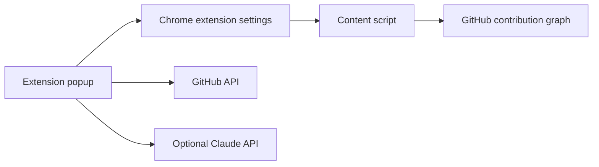

# GitHub Bloom

GitHub contribution graph theme customization and AI-assisted developer activity exploration — a Chrome extension prototype.

## Features
- Seven contribution graph color themes and preview.
- Browser-side theme application to GitHub contribution cells.
- Activity summaries and optional Claude-powered analysis.

## Architecture

## Local installation
1. Clone or download this repository.
2. Open `chrome://extensions` and enable Developer mode.
3. Select Load unpacked and choose `github-customizer/`.
4. Consult the [extension documentation](github-customizer/README.md) for setup details.

## Limitations
GitHub DOM changes may affect selectors and activity summaries. Contribution counts do not measure code quality or individual productivity. Optional external API calls require user-provided credentials; never commit API keys. Chrome Web Store publication and clean-install testing are not verified here.
